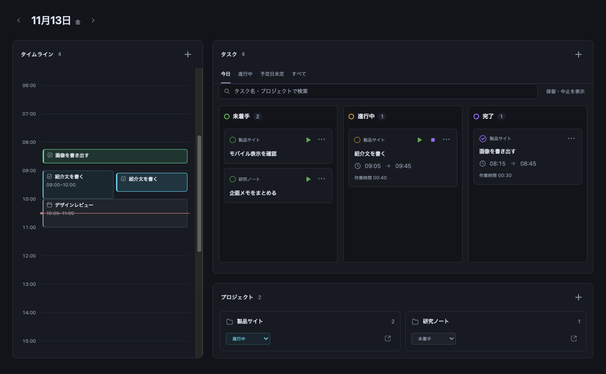
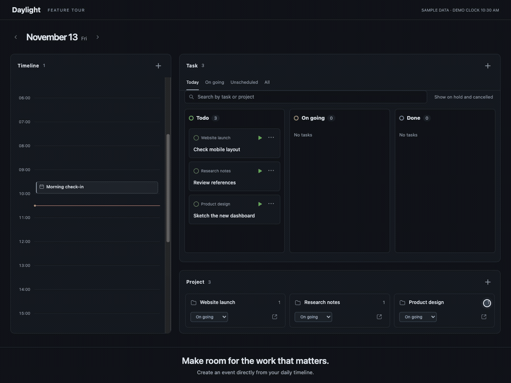
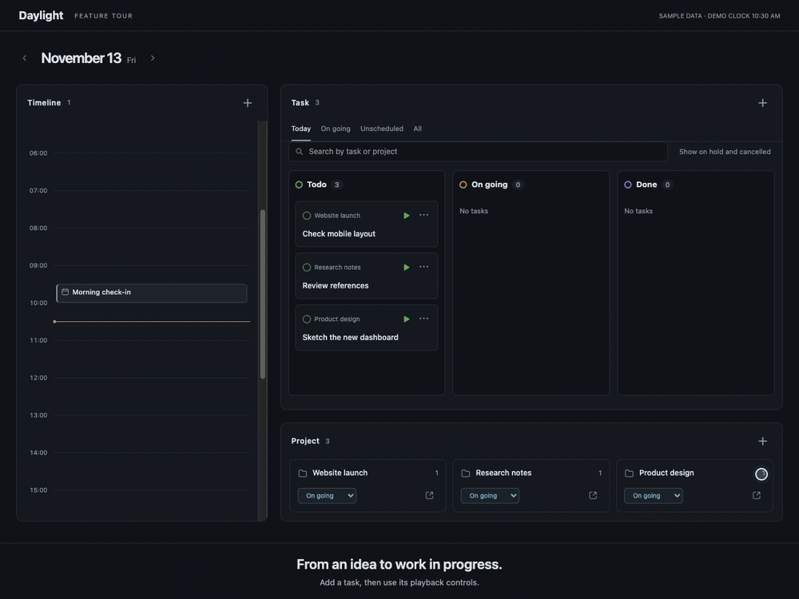
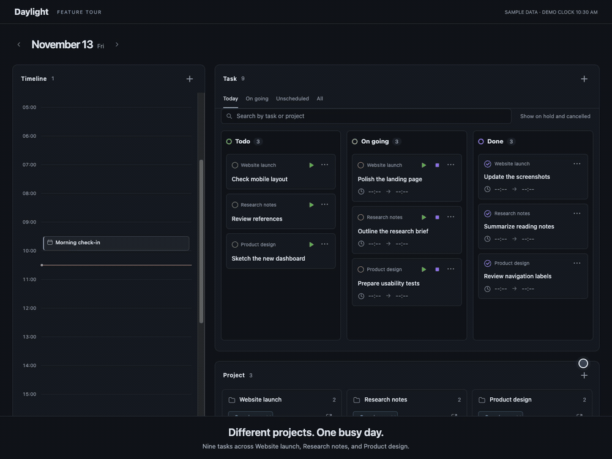

<div align="center">

<h1> Daylight</h1>

**一日の予定とタスクを、Obsidianのひとつの画面に。**

タイムライン、カンバン、プロジェクトを行き来せずに、計画から実行まで。

[English](README.md) · **日本語**

[](https://obsidian.md/)
[](#インストール)
[](#表示言語を選ぶ)
[](LICENSE)

[主な機能](#一日の流れをひとつの画面で) · [インストール](#インストール) · [使い始める](#最初の一日を始める) · [言語](#表示言語を選ぶ)

</div>



*架空のサンプルデータを使い、実際のDaylightのUIをブラウザープレビューで描画した画像です。Obsidianのテーマや画面サイズによって見た目は変わります。*

## 一日の流れをひとつの画面で

| 時間を見渡す | タスクを動かす | プロジェクトに集中する |
| :--- | :--- | :--- |
| 予定、時間を決めたタスク、実際に作業した時間をタイムラインに表示。 | カードの状態や順序を変え、大きな作業を子タスクに分ける。 | プロジェクトで一日を絞り込み、関連するノートを開く。 |

以下の3本は、英語UIと架空のデータを使ったブラウザーデモです。タスク編の時間経過はシミュレーションで、Vaultには接続していません。

### タイムラインで一日を組み立てる



<sub><em>デモ動画ではComputer Useによって操作されており、実際にはより軽快に動作します。</em></sub>

会議と作業の予定をまとめて表示し、現在時刻の線で今の位置を確認できます。重なった予定も並べて表示し、日をまたぐ予定や実績にも対応します。

空白をドラッグして時間帯を選び、ハンドルで調整して予定を追加できます。範囲選択は30分刻み、作成画面では1分単位の時刻を指定できます。登録済みの予定はクリックして編集します。

### カンバンでタスクを進める



<sub><em>デモ動画ではComputer Useによって操作されており、実際にはより軽快に動作します。</em></sub>

通常は**未着手・進行中・完了**の3列を表示し、必要に応じて**保留・中止**も表示できます。

- カードを別の列にドラッグして状態を変更。
- 同じ列のカード上端・下端へドロップして並べ替え。
- カード中央へのドロップ、またはメニューから親タスクを設定。
- **今日・進行中・予定日未定・すべて**を切り替え、タスク名やプロジェクトで検索。
- 選択日の画面には、過去からの持ち越しと、その日に完了したタスクも表示。

### 実際に作業した時間を残す

カードのボタンで**開始・一時停止・再開・終了**を操作できます。作業を区切って記録するため、休憩時間は合計に含まれません。複数タスクの並列実行も可能です。

実績は元の予定を残したままタイムラインに表示します。タスクの詳細から、各作業セッションと終了済みの合計作業時間を確認できます。

### プロジェクトとノートをつなぐ



<sub><em>デモ動画ではComputer Useによって操作されており、実際にはより軽快に動作します。</em></sub>

プロジェクトを作成してゴールを設定し、タスクや予定をひも付けられます。プロジェクトを選ぶと、その作業にダッシュボードを絞り込めます。親カードには直接の子タスクと完了件数を表示します。

タスクの詳細では、予定日、締切、リンク、独自のプロパティを編集できます。作業中のメモを追記したり、元のMarkdownノートをObsidianで開いたりできます。

### データはVault内のノートに

タスク・予定・プロジェクトは、通常どおり開いて編集できるMarkdownノートです。専用アカウントや別サーバーは不要で、ローカルで動作します。ライト／ダークテーマに対応し、スマートフォンでは状態列を縦に並べます。

## プライバシーと対応環境

- **オフラインで動作：** プラグインからの外部通信、利用状況の収集、広告、課金、アカウント登録はありません。
- **Vault内に保存：** ノート・テンプレート・プラグイン設定はVault内に保存します。プラグインがVault外のファイルにアクセスすることはありません。Obsidian Syncなど、別途有効にした同期サービスの動作は独立しています。
- **対応環境：** Obsidian **1.8.7以降**のデスクトップ版・モバイル版。ライト／ダークテーマに対応しています。

## インストール

**Obsidian 1.8.7以降**が必要です。現在は手動インストールに対応しており、コミュニティプラグイン一覧への登録は準備中です。

1. [最新のGitHub Release](https://github.com/Gonsix/daylight/releases/latest)から `main.js`・`manifest.json`・`styles.css` をダウンロードします。
2. Vault内に `.obsidian/plugins/daylight/` を作成し、3ファイルを配置します。Obsidianの設定フォルダを変更している場合は、`.obsidian` をそのフォルダ名に置き換えてください。
3. Obsidianを再起動し、**設定 → コミュニティプラグイン**でDaylightを有効にします。

更新時は同じ3ファイルを置き換え、Daylightを再読み込みしてください。既存の `data.json` は残してください。変更内容は[更新履歴](CHANGELOG.md)に記載しています。

リポジトリの最新コードを使う場合や開発する場合は、[ソースからのインストール](#ソースからのインストール)を参照してください。

## 最初の一日を始める

1. **ダッシュボードを開く。** 日の出のリボンアイコン、またはコマンドパレットの **Daylight: ダッシュボードを開く**を使います。
2. **タスクを追加する。** タスク欄の**＋**から、予定日、プロジェクト、必要なら開始・終了や締切を入力します。
3. **時間を確保する。** タイムラインで範囲を選び、予定を追加します。
4. **実行して振り返る。** タスクを開始し、休憩時には一時停止、終わったら終了。作業セッションや完了カードを確認します。

初回起動時に保存フォルダとテンプレートが用意されます。既定の保存先は `Daylight/` です。**設定 → Daylight → Daylightフォルダの配置場所**で変更でき、保存すると既存のDaylightフォルダもまとめて移動します。

ホーム画面として使う場合は、**起動時にDaylightを開く**をオンにします。他のノートは閉じません。別プラグインやObsidian本体の起動設定によっては、Daylightの前にノートが表示されることがあります。

## 表示言語を選ぶ

**設定 → Daylight → Language（言語）**から選択します。既定は英語です。言語を変えても、ノートの内容やファイル名は変わりません。

| 言語 | 設定に表示される名前 |
| :--- | :--- |
| 英語 | English |
| 日本語 | 日本語 |
| 中国語・簡体字 | 简体中文 |
| 中国語・繁体字 | 繁體中文 |
| スペイン語 | Español |
| ドイツ語 | Deutsch |
| フランス語 | Français |
| 韓国語 | 한국어 |
| ポルトガル語・ブラジル | Português (Brasil) |

READMEは[英語版](README.md)も用意しています。READMEの言語切り替えと、プラグイン内の言語設定はそれぞれ独立しています。

## ノートの中に表示する

閲覧モードやライブプレビューで今日のダッシュボードを表示するには、ノートに次のコードブロックを追加します。

````markdown
```daylight
date: today
```
````

特定の日を表示する場合は、`date: "2026-11-13"` のように日付を指定します。

`date` を省略すると、`daily_notes/01_daily/YYYY-MM-DD.md` 内ではファイル名の日付、それ以外では今日を表示します。旧 `vault-dashboard` コードブロックも引き続き使用できます。

## 知っておくと便利なこと

- **テンプレートの展開範囲：** 同梱テンプレートの日付・frontmatter用トークンに対応しています。任意のTemplater JavaScriptは実行しません。
- **タッチ操作：** ドラッグ＆ドロップが使えない場合は、状態や親タスクの選択欄から変更できます。

- **日付・時刻は端末のローカルタイムゾーン基準。** 予定日と締切は別々に設定できます。
- **メモは送信して保存。** 未送信の下書きは同じ画面内で項目を切り替えても残りますが、ビューを閉じると失われます。
- **削除の対象は元のノート。** Obsidianの設定に従ってゴミ箱へ移動します。プロジェクトを削除しても、所属するタスクや予定は削除しません。
- **使い始める前にバックアップを。** DaylightはVault内のノートを編集します。
- **現在の対象外：** Googleカレンダー同期、既存の予定をドラッグして日時変更する操作。日時は予定の編集画面から変更してください。

## ソースからのインストール

Git、Node.js、npm、Bashが使える環境で実行します。

```sh
git clone https://github.com/Gonsix/daylight.git
cd daylight
./install.sh "/path/to/My Vault"
```

必要に応じて依存関係をインストールし、ビルドした3ファイルをVaultへ配置します。既存のプラグイン設定は保持されます。更新後はObsidianでDaylightを再読み込みしてください。

<details>
<summary>開発用コマンドと技術ドキュメント</summary>

```sh
npm ci
npm run validate
npm run release:prepare
```

保存形式、起動処理、作業実績、多言語対応などの詳細は[機能仕様](docs/specs/README.md)を参照してください。

</details>

開発・配布前の確認方法は[リリース手順](docs/releasing.md)を参照してください。

## フィードバック

不具合や改善案は[Issues](https://github.com/Gonsix/daylight/issues)へお寄せください。不具合の報告には、DaylightとObsidianのバージョン、端末、表示言語、再現手順を記載してください。

## ライセンス

Copyright © 2026 Gonsix. Daylightは[MITライセンス](LICENSE)で公開しています。

第三者のライブラリやObsidianのブランド素材には、それぞれのライセンス・利用条件が適用されます。Daylightは独立したコミュニティプロジェクトであり、Obsidianとの提携や公式の推奨を示すものではありません。

同梱ライブラリのライセンスは[サードパーティのライセンス表記](THIRD_PARTY_NOTICES.md)を参照してください。
