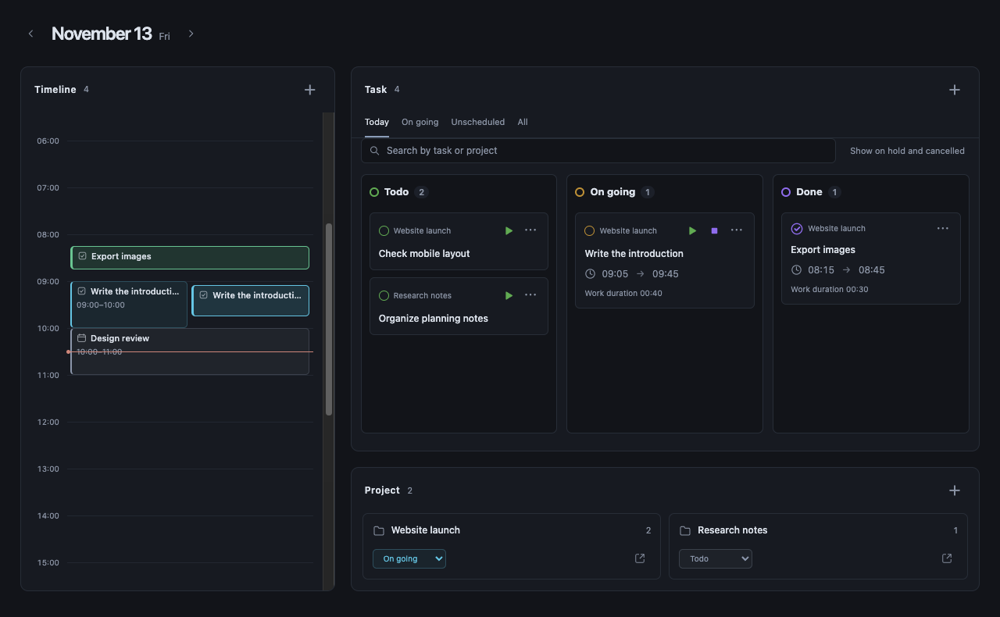
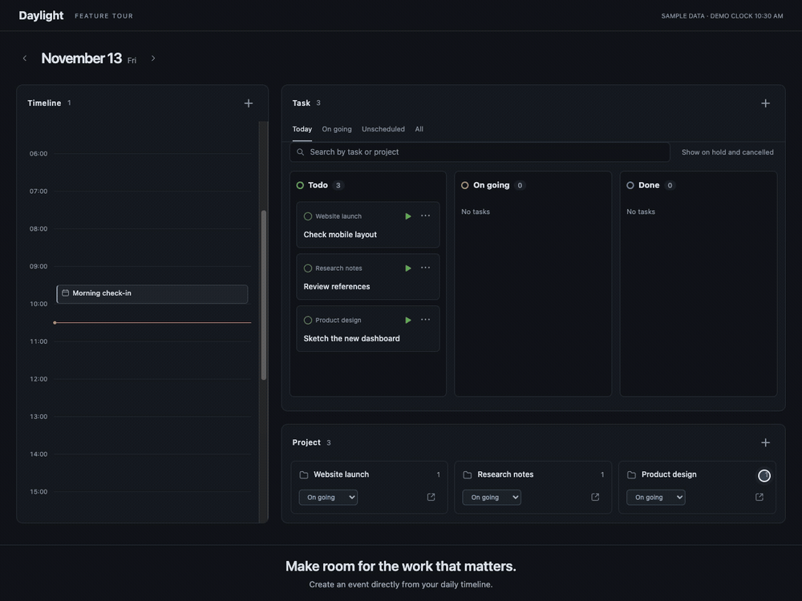
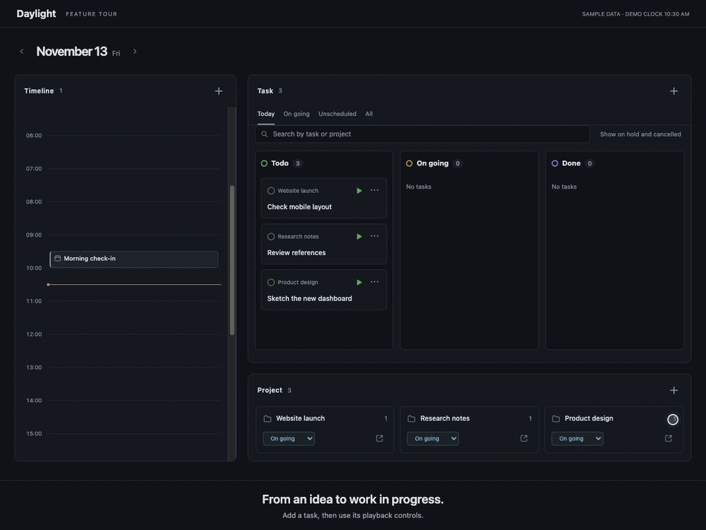
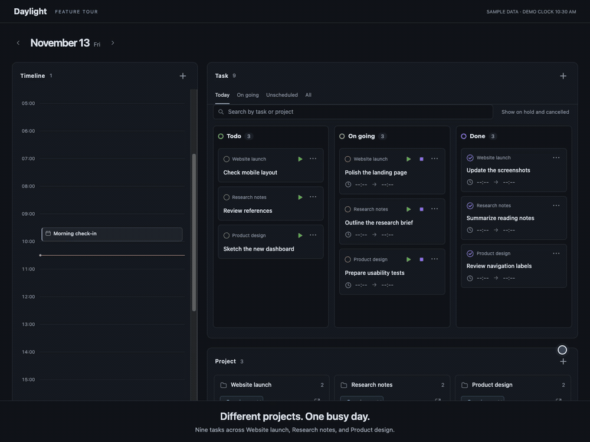

<div align="center">

# Daylight

**Plan your day. Move your work forward. Keep it in Obsidian.**

A daily timeline, a Kanban board, and your projects — together in one view.

**English** · [日本語](README.ja.md)

[](https://obsidian.md/)
[](#install)
[](#choose-your-language)
[](LICENSE)

[Features](#one-place-for-your-day) · [Install](#install) · [Get started](#your-first-day-with-daylight) · [Languages](#choose-your-language)

</div>



*The Daylight UI rendered with fictional sample data in a browser preview. Obsidian themes and screen sizes may change its appearance.*

## One place for your day

| See your time | Organize your tasks | Stay connected to projects |
| :--- | :--- | :--- |
| View events, scheduled tasks, and actual work on a daily timeline. | Move cards through your workflow, choose their order, and break work into subtasks. | Filter your day by project and open the notes behind your work. |

The three demos below use the English UI and fictional data in an isolated browser preview. Task time jumps are simulated; no vault data is used.

### Plan on the timeline



<sub><em>The demos are operated using Computer Use; the interface responds more quickly during normal use.</em></sub>

See meetings and scheduled work together, with a current-time line to find your place in the day. Overlapping events share the timeline, and work that crosses midnight appears on the days it belongs to.

Drag an empty area to select a time range, adjust its handles, and add an event. Selection uses 30-minute steps; the event form lets you set times to the minute. Click an existing event to edit it.

### Keep tasks moving



<sub><em>The demos are operated using Computer Use; the interface responds more quickly during normal use.</em></sub>

The Kanban board shows **Todo**, **On going**, and **Done**, with **On hold** and **Cancelled** available when you need them.

- Drag cards between columns to change their status.
- Drop near the top or bottom of a card to reorder tasks in the same column.
- Drop in the center of a card to make it a parent task, or choose a parent from the menu.
- Switch between **Today**, **On going**, **Unscheduled**, and **All**, or search by task or project.
- Keep unfinished work in view: the selected day also includes carryovers and tasks completed that day.

### Record the work you actually do

Use the controls on a task card to **start, pause, resume, and finish** work. Daylight keeps separate work sessions, so breaks do not count toward your work duration. You can run more than one task at a time.

Actual work appears alongside the original schedule. Review your sessions and total completed work time in the task details.

### Bring projects and notes together



<sub><em>The demos are operated using Computer Use; the interface responds more quickly during normal use.</em></sub>

Create projects, set goals, and connect tasks and events to them. Select a project to focus the dashboard on its work. Parent tasks show their direct subtasks and completion counts.

Open task details to edit dates, deadlines, links, and custom properties. Add a note while you work, or open the underlying Markdown note in Obsidian.

### Your notes stay in your vault

Tasks, events, and projects are Markdown files you can open and edit normally. Daylight runs locally without a separate account or server. Light and dark themes, desktop layouts, and a stacked task board on phones are supported.

## Install

Daylight requires **Obsidian 1.8.7 or later**. Manual installation is currently supported; community plugin listing is being prepared.

1. Download `main.js`, `manifest.json`, and `styles.css` from [GitHub Releases](https://github.com/Gonsix/daylight/releases).
2. Create `.obsidian/plugins/daylight/` inside your vault and place the three files there.
3. Restart Obsidian, then enable **Daylight** in **Settings → Community plugins**.

For the current source version or local development, see [Build from source](#build-from-source).

## Your first day with Daylight

1. **Open your dashboard.** Use the calendar-clock ribbon icon or run **Daylight: Open Daylight** from the command palette.
2. **Add something to do.** Use **＋** in the task section. Choose a date, project, and optional scheduled time or deadline.
3. **Make room for it.** Select a range on the timeline to add an event.
4. **Work and review.** Start a task, pause for a break, and finish it when done. Check the work sessions and your completed cards.

On first use, Daylight prepares its folders and note templates. The default location is `Daylight/`. You can change it from **Settings → Daylight → Daylight folder location**; saving moves the existing Daylight folders together.

To use Daylight as your starting view, turn on **Open Daylight on startup**. Existing notes remain open. Another startup plugin or Obsidian's own startup-note setting can still open a note before Daylight appears.

## Choose your language

Open **Settings → Daylight → Language**. English is the default, and changing the interface language keeps your note content and filenames intact.

| Language | Shown in settings |
| :--- | :--- |
| English | English |
| Japanese | 日本語 |
| Simplified Chinese | 简体中文 |
| Traditional Chinese | 繁體中文 |
| Spanish | Español |
| German | Deutsch |
| French | Français |
| Korean | 한국어 |
| Brazilian Portuguese | Português (Brasil) |

This README is available in [Japanese](README.ja.md), too. README language links and the plugin's language setting are separate.

## Put Daylight inside a note

Add this code block to a note to show today's dashboard in Reading view or Live Preview:

````markdown
```daylight
date: today
```
````

For a specific day, use a quoted date such as `date: "2026-11-13"`.

If you omit `date`, notes in `daily_notes/01_daily/YYYY-MM-DD.md` use the date in their filename; other notes show today. The older `vault-dashboard` code block is also supported.

## Useful to know

- **Dates use your device's local time zone.** A scheduled date and a deadline are separate fields.
- **Notes save when you submit.** Unsaved note drafts stay while switching items in the same view, but are lost when that view closes.
- **Deleting removes the source note.** Daylight uses Obsidian's trash behavior. Deleting a project does not delete its tasks or events.
- **Keep a backup before getting started.** Daylight edits the notes stored in your vault.
- **Current limits:** Google Calendar sync and dragging an existing event to reschedule it are not included. Open the event form to change its time.

## Build from source

With Git, Node.js, npm, and Bash installed:

```sh
git clone https://github.com/Gonsix/daylight.git
cd daylight
./install.sh "/path/to/My Vault"
```

The script installs dependencies if needed, builds the plugin, and copies its three distribution files into the vault. Existing plugin settings are preserved. Reload Daylight in Obsidian after updating.

<details>
<summary>Development commands and technical documentation</summary>

```sh
npm ci
npm run check
npm test
npm run build
```

See the [feature specifications](docs/specs/README.md) for storage, startup, task execution, and localization details. The specifications are currently written in Japanese.

</details>

## Feedback

Found a problem or have an idea? [Open an issue](https://github.com/Gonsix/daylight/issues). For bugs, include your Daylight and Obsidian versions, device, interface language, and steps to reproduce the problem.

## License

Copyright © 2026 Gonsix. Daylight is released under the [MIT License](LICENSE).

Third-party dependencies and Obsidian branding retain their respective licenses and terms. Daylight is an independent community project and is not affiliated with or endorsed by Obsidian.
